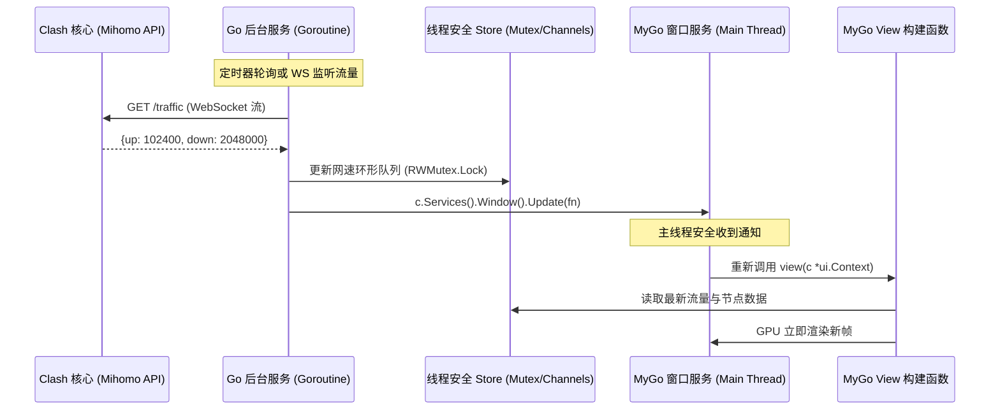

# Clash-Go 架构与布局区块设计指南 (DESIGN.md)

本文档是 `clash-go`（基于 Go + [MyGo](https://github.com/egoist/mygo) 原生 GPU 组件构建的 Clash 桌面客户端）的核心架构与 UI 布局设计指南。
功能与业务逻辑全面参考成熟客户端 `clash-verge-rev`，并深度适配 MyGo 的原生声明式 UI 生命周期与并发模型。

---

## 1. 架构总览与技术哲学

### 1.1 与传统客户端 (clash-verge-rev / Electron) 对比

| 维度 | clash-verge-rev (Tauri v2 + React) | clash-go (Go + MyGo 原生) |
| :--- | :--- | :--- |
| **GUI 渲染引擎** | Webview2 / WebKit (DOM + CSS) | GPU 直接绘制 (Metal / DirectX / Vulkan) |
| **运行时依赖** | Node.js / Rust / Webview 动态库 | **零 Webview、零 Node、单静态二进制** |
| **内存占用** | 约 120MB ~ 250MB | **约 15MB ~ 30MB** |
| **冷启动速度** | 800ms ~ 2000ms | **< 50ms (瞬时启动)** |
| **跨进程通信** | Webview ↔ Rust IPC (JSON 序列化) | **零 IPC 开销 (Go 内存直通与通道协作)** |
| **构建跨平台** | 需要 C/C++ 工具链与平台 Webview | `CGO_ENABLED=0` 纯 Go 交叉编译 |

### 1.2 系统分层架构

```mermaid
flowchart TD
    subgraph UI_Layer ["UI 呈现层 (MyGo GPU 直绘)"]
        Window["MyGo Window (*ui.Context)"]
        Shell["AppShell (Sidebar + Header + Status)"]
        Views["Views (Dashboard / Proxies / Profiles / Connections / Rules / Logs / Settings)"]
        Widgets["Base Widgets (GridView, Table, Chart, Segmented, Switch, Modal)"]
    end

    subgraph Store_Layer ["应用状态存储层 (Thread-Safe Store)"]
        AppStore["In-Memory AppStore (RWMutex / atomic)"]
        EventBus["Event Dispatcher (Window.Update 通知)"]
    end

    subgraph Service_Layer ["核心服务层 (Go Goroutines)"]
        CoreManager["Clash Core Daemon (Mihomo Sidecar / Embedded)"]
        RestClient["Clash REST API Client (Proxies / Rules / Config)"]
        WsStreamer["WebSocket Streamer (Traffic / Logs / Connections)"]
        SysProxy["Platform SysProxy / TUN Manager (macOS, Win, Linux)"]
        ProfileMgr["Profile & Subscription Sync Manager"]
    end

    Window --> Shell --> Views --> Widgets
    Views -.读取状态与触发动作.-> AppStore
    EventBus -.window.Update(fn).-> Window
    Service_Layer --> AppStore
    Service_Layer --> EventBus
```

---

## 2. 全局应用外框 (App Shell) 布局设计

整个客户端窗口采用桌面原生主流的**三段式现代化结构**：左侧固定/折叠导航栏、顶部拖拽与快捷操作栏、中间主视口滚动区域、底部状态监控栏。

### 2.1 窗口几何规格与属性

- **默认尺寸**：`960 × 640`
- **最小限制**：`760 × 520`
- **窗口特性**：
  - 无边框拖拽支持：顶部预留系统红绿灯区（macOS）或 Windows/Linux 原生按钮。
  - 记忆窗口位置与尺寸：`StateKey: "clash-go-main"`。

### 2.2 App Shell 视觉结构线框 (ASCII Wireframe)

```
+-----------------------------------------------------------------------------------------------+
| [Logo] clash-go       | Header: [当前页面标题]             [ 规则 | 全局 | 直连 ]  [⟳ 重载核心] [⚙] |
+-----------------------+-----------------------------------------------------------------------+
|  📊 仪表盘 (Dashboard)|                                                                       |
|  ⚡ 代理节点 (Proxies)|                                                                       |
|  📑 订阅配置(Profiles)|                                                                       |
|  🌐 连接监控 (Conns)  |                      主视口内容展示区域                                 |
|  🔀 分流规则 (Rules)  |                   (动态加载当前选中的 View)                            |
|  📜 运行日志 (Logs)   |                                                                       |
|  ⚙️ 偏好设置(Settings)|                                                                       |
|                       |                                                                       |
|-----------------------|                                                                       |
| [系统代理开关]  [ON]  |                                                                       |
| [TUN模式开关]   [OFF] |                                                                       |
+-----------------------+-----------------------------------------------------------------------+
| 核心: Mihomo v1.18.7  |  ↑ 124 KB/s   ↓ 1.4 MB/s  | 内存: 24.8 MB | 连接数: 18  | 延迟: 42ms |
+-----------------------------------------------------------------------------------------------+
```

### 2.3 导航菜单定义

| 标识 (Tab ID) | 名称 | 对应图标 | 快捷键 | 核心功能概述 |
| :--- | :--- | :--- | :--- | :--- |
| `dashboard` | 仪表盘 | `DashboardIcon` | `Cmd/Ctrl+1` | 实时上下行网速折线图、流量统计、快捷开关、IP地理位置、核心状态 |
| `proxies` | 节点选择 | `NetworkIcon` | `Cmd/Ctrl+2` | 代理分组折叠面板、节点网格卡片、批量延迟测速、排序与过滤 |
| `profiles` | 订阅配置 | `DocumentIcon` | `Cmd/Ctrl+3` | 远端订阅拉取、本地配置管理、自动更新定时器、内置配置编辑器 |
| `connections`| 连接监控 | `ActivityIcon` | `Cmd/Ctrl+4` | 实时网络连接表格、按进程/域名搜索、单条/全部断开、详情抽屉 |
| `rules` | 分流规则 | `ForkIcon` | `Cmd/Ctrl+5` | 规则列表检索、规则集 (Rule Providers) 状态展示与一键更新 |
| `logs` | 实时日志 | `TerminalIcon` | `Cmd/Ctrl+6` | 核心日志流展示、级别筛选 (Debug/Info/Warn/Error)、关键字过滤与导出 |
| `settings` | 偏好设置 | `SlidersIcon` | `Cmd/Ctrl+,` | Clash 核心端口、系统代理旁路、TUN 网卡栈、开机启动与托盘配置 |

---

## 3. 各模块详细布局区块设计 (Layout Blocks)

---

### 3.1 模块 1：仪表盘 (Dashboard / Home)

仪表盘旨在提供**一目了然的网络健康状况与核心控制能力**。

#### 布局网格规划 (2-Column Grid / Responsive Column)
```
+-----------------------------------------------------------------------+
| [ 上行/下行 实时流量折线图 (mygo/ui/chart 渲染，保留近 60s 数据) ]      |
|   ↑ 240 KB/s (峰值: 1.2 MB/s)         ↓ 3.8 MB/s (峰值: 18.5 MB/s)     |
+-----------------------------------+-----------------------------------+
| 快捷模式控制卡片                  | 外网出海与 IP 归属卡片            |
| • 系统代理: [ 开关 ]              | • 出口 IP: 104.28.x.x             |
| • TUN 虚拟网卡: [ 开关 ]          | • 国家/地区: 🇭🇰 香港 (HK)         |
| • 运行模式: [规则 | 全局 | 直连]  | • 运营商: Cloudflare / CDN        |
| • 当前节点: 🇭🇰 HK-BGP-01 (45ms)  | • 本地网络延迟: 38 ms             |
+-----------------------------------+-----------------------------------+
| 核心运行状态卡片                  | 常用快捷入口卡片                  |
| • 核心类型: Mihomo (Meta)         | • [ ⚡ 一键节点测速 ]             |
| • 运行时间: 3天 14小时 22分       | • [ ⟳ 立即更新订阅 ]             |
| • 占用内存: 28.4 MB (Go 协程: 84) | • [ 🗑️ 清理全部连接 ]             |
| • 监听端口: Mixed:7890 API:9090   | • [ 📁 打开配置目录 ]             |
+-----------------------------------+-----------------------------------+
```

#### 关键原生组件选用：
1. **流量折线图**：使用 `github.com/egoist/mygo/ui/chart`，构建线性刻度 `chart.NewLinear`，搭配平滑采样点 `chart.Downsample`，上行用橙色 (`Theme.Warning`)，下行用强调色 (`Theme.Accent`)。
2. **快捷开关**：`ui.Switch(c, &store.SystemProxyEnabled)`。
3. **分流模式切换**：`ui.Segmented(c, &store.OutboundModeIdx, "规则", "全局", "直连")`。

---

### 3.2 模块 2：代理节点 (Proxies)

参考 `clash-verge-rev` 的代理视图设计，提供**分组折叠、策略组切换、节点卡片瀑布流网格与快速测速**。

#### 布局层次划分：
```
+-----------------------------------------------------------------------+
| 顶部操作条:                                                           |
| [ 策略组选择下拉/Tabs ]   [搜索节点 🔍]  [排序方式 ▾]  [⚡ 测速当前组] |
+-----------------------------------------------------------------------+
| 策略组总览面板 (Accordion / Horizontal Bar):                          |
|  [ 🚀 节点选择 (24) ]  [ 🐟 漏网之鱼 (Direct) ]  [ 🤖 AI 专线 (8) ]   |
+-----------------------------------------------------------------------+
| 节点网格卡片区 (ui.GridView 或自适应多列 Row):                        |
| +-------------------------+ +-------------------------+               |
| | 🇭🇰 香港 01 - 专线       | | 🇯🇵 日本 01 - 原生       |               |
| | 类型: Shadowsocks       | | 类型: Vmess             |               |
| | 延迟: [ 45ms (绿色) ]   | | 延迟: [ 88ms (绿色) ]   |               |
| | [✔ 选中激活状态]        | |                         |               |
| +-------------------------+ +-------------------------+               |
| +-------------------------+ +-------------------------+               |
| | 🇺🇸 美国 01 - 备用       | | 🇸🇬 新加坡 01 - 负载均衡 |               |
| | 类型: Trojan            | | 类型: Hysteria2         |               |
| | 延迟: [ 180ms (黄色) ]  | | 延迟: [ 超时 (红色) ]   |               |
| +-------------------------+ +-------------------------+               |
+-----------------------------------------------------------------------+
```

#### 节点卡片视觉规范：
- **卡片尺寸**：宽 `180px ~ 220px`，高 `72px`。
- **状态响应**：
  - 未选中：背景 `Theme.Surface`，边框 `Theme.Border`。
  - 悬停 (Hover)：边框微亮，显示测试按钮。
  - 选中激活：外框高亮 `Theme.Accent`，右侧带对勾图标 `ui.Icon`。
- **延迟徽章 (Badge)**：
  - `< 100ms`：淡绿色背景 + 绿色文字 (`Theme.Success`)。
  - `100ms ~ 300ms`：淡黄色背景 + 橙色文字 (`Theme.Warning`)。
  - `> 300ms 或超时`：淡红色背景 + 红色文字 (`Theme.Danger`)。

---

### 3.3 模块 3：订阅配置 (Profiles)

管理远端 Clash 订阅、本地覆写规则、Merge 配置与自定义脚本。

#### 布局设计：
```
+-----------------------------------------------------------------------+
| 操作工具栏:                                                           |
| [+ 新建/添加订阅]   [📥 导入本地文件]   [⟳ 一键更新全部]   [📁 配置目录]|
+-----------------------------------------------------------------------+
| 订阅卡片列表:                                                         |
| +-------------------------------------------------------------------+ |
| | (•) 我的主力机场 [主配置]                         [⟳ 更新] [✎] [🗑] | |
| |     类型: 远程订阅 (URL)   节点数: 48    最后更新: 10分钟前       | |
| |     已用流量: 142.5 GB / 500 GB (进度条 28.5%)    有效期至: 2027  | |
| +-------------------------------------------------------------------+ |
| +-------------------------------------------------------------------+ |
| | ( ) 备用自建节点配置                              [⟳ 更新] [✎] [🗑] | |
| |     类型: 本地配置 (YAML)  节点数: 6     更新时间: 昨天           | |
| +-------------------------------------------------------------------+ |
+-----------------------------------------------------------------------+
```

#### 交互细节：
- 点击单选圆钮立即无缝切换配置并通知核心重载 (`POST /configs?force=true`)。
- 点击编辑弹出内置编辑弹窗 (`ui.Modal`)，支持查看和编辑 YAML 配置文本。

---

### 3.4 模块 4：连接监控 (Connections)

排查异常流量、追踪应用程序走哪条规则出海的强力工具。

#### 布局设计：
```
+-----------------------------------------------------------------------+
| 工具条: [🔍 搜索域名/IP/进程]  [规则过滤 ▾]  [⏸ 暂停刷新]  [🗑️ 断开全部] |
+-----------------------------------------------------------------------+
| 连接数据表 (采用 ui.Table 原生虚拟滚动列表):                         |
| 目标地址 / 域名   | 进程名称     | 匹配规则     | 目标节点  | 速率 / 流量 |
|-------------------|--------------|--------------|-----------|-------------|
| api.github.com    | git-credential| Match(Proxy) | 🇭🇰 HK-01  | ↑0B ↓1.2KB  |
| www.google.com    | chrome       | GFWList      | 🇯🇵 JP-01  | ↑12K ↓450KB |
| api.ipify.org     | clash-go     | Direct       | DIRECT    | ↑0B ↓420B   |
+-----------------------------------------------------------------------+
| 底部统计: 共 14 条活跃连接  |  累计上传: 1.8 MB  |  累计下载: 42.6 MB       |
+-----------------------------------------------------------------------+
```

#### 关键组件实现：
- 使用 `ui.Table(c, listState, columns, n, cellBuilder)` 承载高频连接数据。
- 单击行可展开侧边浮层，查看完整的元数据：源 IP/端口、DNS 查询耗时、Chains 链路、TLS SNI。

---

### 3.5 模块 5：分流规则 (Rules)

#### 布局设计：
```
+-----------------------------------------------------------------------+
| 顶部过滤: [ 🔍 搜索规则关键词 / 目标 ]   [类型过滤: 全部 | DOMAIN | IP-CIDR ] |
+-----------------------------------------------------------------------+
| 规则集 Providers 面板 (可折叠):                                       |
|  • reject-rules (远程)  - 1,200 条规则  [⟳ 刷新]                      |
|  • direct-rules (远程)  - 4,500 条规则  [⟳ 刷新]                      |
+-----------------------------------------------------------------------+
| 规则列表 (ui.Table):                                                  |
| 序号 | 规则类型       | 匹配内容 (Payload)     | 目标代理策略组       |
|------|----------------|------------------------|----------------------|
| 1    | DOMAIN-SUFFIX  | google.com             | 🚀 节点选择          |
| 2    | DOMAIN-KEYWORD | telegram               | ✈️ 电报消息          |
| 3    | IP-CIDR        | 192.168.0.0/16         | DIRECT               |
| 4    | GEOIP          | CN                     | DIRECT               |
| 5    | MATCH          |                        | 🐟 漏网之鱼          |
+-----------------------------------------------------------------------+
```

---

### 3.6 模块 6：运行日志 (Logs)

#### 布局设计：
```
+-----------------------------------------------------------------------+
| 控制条: [ 全部 | INFO | WARNING | ERROR | DEBUG ]  [🔍 过滤] [🗑 清空] [导出]|
+-----------------------------------------------------------------------+
| 实时日志流视口 (固定 2000 行 Ring-Buffer，自动锁定底部):              |
| [16:32:01] [INFO] [TCP] 127.0.0.1:54321 --> api.github.com:443 match...|
| [16:32:05] [WARN] [DNS] exchange failed for raw.githubusercontent.com |
| [16:32:08] [INFO] [Rule] match GeoIP(CN) -> DIRECT                    |
+-----------------------------------------------------------------------+
```

---

### 3.7 模块 7：偏好与高级设置 (Settings)

设置分为左右或卡片分组式呈现：

1. **Clash 核心与网络设置**：
   - 混合端口 (Mixed Port，默认 7890)、Socks5、Redir、TProxy 端口设置。
   - 允许来自局域网的连接 (Allow LAN) 开关与绑定网卡。
   - IPv6 流量解析开关、外部控制器地址 (`127.0.0.1:9090`) 与通信密钥 Secret。
2. **系统代理与 TUN 模式**：
   - 系统代理一键开关与自动绕过局域网地址。
   - 自定义系统代理绕过名单 (Bypass Domain List)。
   - TUN 虚拟网卡模式开关、协议栈选择 (`gVisor` / `System` / `Mixed`)、严格路由、DNS 劫持。
3. **外观与系统交互**：
   - 主题切换：跟随系统 / 明亮浅色 / 优雅深色 (`ThemeMode`)。
   - 开机静默自启（启动时最小化到系统托盘）。
   - 关闭主窗口行为：最小化到托盘 vs 退出程序。
4. **全局快捷键**：
   - 快速显示/隐藏主窗口 (`Cmd/Ctrl + Shift + S`)。
   - 一键开启/关闭系统代理 (`Cmd/Ctrl + Shift + P`)。
5. **版本与更新**：
   - 检查客户端更新、查看 Release 说明、自动静默下载补丁。

---

## 4. 组件映射对照表 (`clash-verge-rev` vs `clash-go`)

为方便将 `clash-verge-rev` 的 React 组件逻辑快速重构为 Go 原生代码，以下为两者的组件映射规范：

| 业务场景 | clash-verge-rev (React / MUI) | clash-go (MyGo `ui` 原生包) |
| :--- | :--- | :--- |
| **侧边导航栏** | `LayoutSidebar`, `<Drawer>` | `ui.Sidebar`, `ui.SidebarItem` |
| **主内容滚动** | `<Box sx={{ overflowY: 'auto' }}>` | `ui.Scroll(c).Fill()` |
| **模式切页** | `<Tabs>`, `<Tab>` | `ui.Tabs(c, &idx, ...)` 或 `ui.Segmented` |
| **开关组件** | `<Switch checked={...} />` | `ui.Switch(c, &boolVal)` |
| **复选框** | `<Checkbox />` | `ui.Checkbox(c, &boolVal, label)` |
| **网速折线图** | ECharts / Recharts 图表库 | `github.com/egoist/mygo/ui/chart` 原生 Plot |
| **连接/规则表格** | MUI `<Table>`, `@tanstack/react-table` | `ui.Table(c, listState, cols, n, cellFn)` |
| **节点网格排列** | MUI `<Grid container spacing={2}>` | `ui.GridView` 或 `ui.Row().Wrap()` |
| **状态/延迟徽标** | MUI `<Chip label="45ms" />` | `ui.Badge(c, "45ms").Background(...)` |
| **对话框 / 弹窗** | `<Dialog>`, `<Modal>` | `ui.Modal(c, &open, fn)` 或 `ui.DialogBase` |
| **气泡卡片 / 悬浮** | `<Popover>`, `<Tooltip>` | `ui.Popover(c, anchor, &open, fn)` / `ui.Tooltip` |
| **搜索与文本输入** | `<TextField>`, `<InputBase>` | `ui.SearchField(c, &query)`, `ui.TextInput` |
| **按钮操作** | `<Button variant="contained">` | `ui.PrimaryButton(c, text)` / `ui.Button(c, text)` |

---

## 5. 数据流与并发线程模型

### 5.1 核心数据交互架构

在 MyGo 中，**严禁在 UI 构建阶段执行任何网络 I/O 或阻塞操作**。
因此，数据流采用典型的「后台 Worker 采集 -> 内存 Store 缓冲 -> `Window.Update` 唤醒 UI 绘制」架构：



### 5.2 状态持久化与配置管理

- **路径标准**：
  - macOS: `~/Library/Application Support/clash-go/`
  - Windows: `%APPDATA%\clash-go\`
  - Linux: `~/.config/clash-go/`
- **文件拆分**：
  - `config.yaml`：客户端基础配置（主题、端口、开机自启、当前激活配置名）。
  - `profiles/`：存放所有下载或新建的 Clash 订阅 YAML 文件。
  - `cores/`：可选存放各平台打包或独立更新的 Mihomo 核心二进制。

---

## 6. 代码目录结构规划 (Package Layout)

按照标准 Go 项目结构布局，职责边界清晰：

```
clash-go/
├── cmd/
│   └── clash-go/              # 应用程序入口 (main.go)
├── internal/
│   ├── app/                   # 应用生命周期、初始化与托盘管理
│   │   ├── app.go
│   │   └── tray.go            # 跨平台系统托盘图标与上下文菜单
│   ├── clash/                 # Clash REST API 客户端与 WebSocket 订阅
│   │   ├── client.go          # HTTP 客户端封装 (GET/POST/PATCH)
│   │   ├── models.go          # Proxies, Rules, Connections, Traffic 结构体
│   │   └── subscriber.go      # 流量、日志流的长连接管理器
│   ├── core/                  # Clash 核心 (Mihomo) 子进程与守护进程管理
│   │   ├── runner.go          # 启动、守护、重启核心
│   │   └── version.go         # 核心版本与特性探测
│   ├── store/                 # 全局响应式状态池 (线程安全)
│   │   ├── store.go
│   │   ├── traffic.go         # 历史网速采样缓冲区
│   │   ├── proxies.go         # 代理分组与测速缓存
│   │   └── profiles.go        # 订阅文件读写与定时器
│   ├── sysproxy/              # 系统代理与 TUN 虚拟网卡平台实现
│   │   ├── sysproxy.go        # 统一接口
│   │   ├── sysproxy_darwin.go # macOS networksetup
│   │   ├── sysproxy_windows.go# Windows wininet 注册表
│   │   └── sysproxy_linux.go  # Linux gsettings / env
│   └── ui/                    # MyGo 原生界面层
│       ├── view.go            # 根视图 (App Shell) 渲染与窗口事件
│       ├── theme.go           # 调色板、圆角、间距与字体定义
│       ├── views/             # 各独立页面
│       │   ├── dashboard.go   # 仪表盘视图与实时图表
│       │   ├── proxies.go     # 节点选择与延迟测速视图
│       │   ├── profiles.go    # 订阅管理视图
│       │   ├── connections.go # 活跃连接表格视图
│       │   ├── rules.go       # 分流规则列表视图
│       │   ├── logs.go        # 日志流控制台视图
│       │   └── settings.go    # 偏好设置视图
│       └── components/        # 可复用的通用业务组件
│           ├── card.go        # 统一样式卡片容器
│           ├── node_card.go   # 节点卡片
│           ├── traffic_plot.go# 原生网速折线图组件
│           └── status_bar.go  # 底部系统状态栏
├── resources/                 # 静态资源 (应用图标、默认配置模板)
├── scripts/                   # 构建与提交校验脚本
├── AGENTS.md                  # AI 协同规则与约束
├── DESIGN.md                  # 本设计规范与架构指南
├── Makefile                   # 统一开发与测试命令
├── mygo.json                  # MyGo 打包清单配置
└── go.mod
```

---

## 7. 实施里程碑 (Roadmap)

1. **Phase 1: 骨架与 Shell 搭建**
   - 实现左侧 `Sidebar`、顶部拖拽区、底部状态栏与路由切页基础结构。
   - 落地 `theme.go` 保证浅色/深色主题无缝切换。
2. **Phase 2: 核心集成与 Store 状态同步**
   - 接入 Clash REST API 客户端与 WebSocket 流量/日志轮询器。
   - 实现仪表盘 `Dashboard` 基础信息卡片与 `ui/chart` 实时网速曲线。
3. **Phase 3: 节点与代理管理 (Proxies)**
   - 实现分组选择、节点网格卡片渲染、一键延迟测速与颜色徽标。
   - 支持模式切换 (Rule / Global / Direct)。
4. **Phase 4: 订阅与连接监控 (Profiles & Connections)**
   - 支持从远程 URL 拉取订阅并解析节点。
   - 搭建 `Connections` 实时连接虚拟表格与快速清理动作。
5. **Phase 5: 系统集成与发布打磨 (SysProxy & Release)**
   - 完善 macOS / Windows 系统代理与 TUN 模式自动切换。
   - 接入系统托盘菜单与窗口关闭拦截。
   - 运行 `make check`，完善基于 `ui.NewTester` 的无窗口端到端自动化测试。
